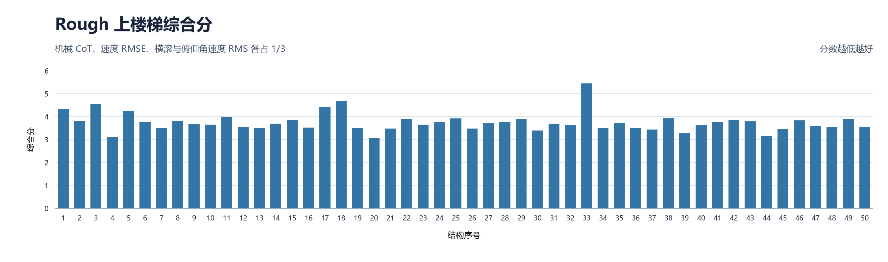
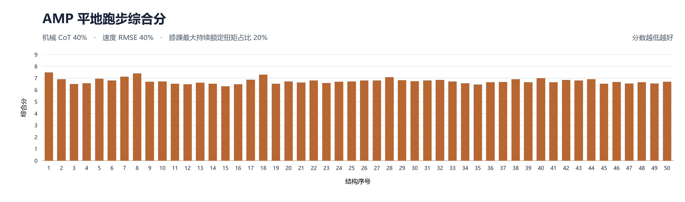

# Rough 与 AMP 专家评估及评分记录

更新于 2026-11-21。Rough 上楼梯和 AMP 平地跑步使用同一批 50 个结构。每个任务单独计算综合分。两张最终图保留原选样顺序，同一编号对应同一套腿长和膝踝电机。

## 样本与固定工况

样本来自 2,500 个结构的冻结排表第 21 组。50 个结构覆盖 25 个膝踝电机组合，每种 2 个。大腿长、小腿长各覆盖 10 档，每档各 5 个。序号 **1–50** 按 AMP 选样清单生成。[编号、结构参数和两项综合分](reference/rough_amp_expert_20261121/structure_scores.csv)

| 工况 | Rough 上楼梯 | AMP 平地跑步 |
|---|---|---|
| 场地 | 沿世界坐标 +X 上直楼梯，1 m 进场段，12 级台阶 | 水平面，沿世界坐标 +X 直跑 |
| 台阶 | 级高 **7.5 cm**，沿前进方向的踏面深度 **30 cm** | — |
| 前向速度指令 | **0.5 m/s** | **1.5 m/s** |
| 试次判定 | 无摔倒，走满 20 秒，平均前向速度至少 0.05 m/s，且登顶 | 无摔倒，跑满 20 秒，平均前向速度至少 0.15 m/s。另记 30 m 路线标记 |
| 检查点 | `model_11999.pt`，训练 12,000 次更新，来自租卡 | `model_4999.pt`，训练 5,000 次更新，在服务器评估 |
| 结果 | 150/150 次走满并登顶，零摔倒 | 150/150 次成功，零摔倒 |

Rough 实际训练级高为 5–10 cm，踏面深度为 25 cm 和 35 cm 两档。评估分别取其算术中点。Rough 的 20 秒窗口也包含登顶后的继续前行。[训练楼梯配置依据](reference/rough_amp_expert_20261121/rough/training_stair_geometry.json)

两项评估均使用 20 秒、0.02 秒控制步长，每次最多 1,000 步。每个结构各跑 3 次，种子为 `20261118`、`20261119` 和 `20261120`。侧向和偏航指令固定为 0，使用确定性策略推理和训练时的观测归一化。评估使用各结构默认关节姿态和零初始速度，关闭观测噪声、随机推力、动力学随机化和初始状态扰动。AMP 使用该结构对应的已验证参考动作，固定从参考库首片段的起点开始。

## 指标与权重

- **整机机械 CoT（C）**用全部 23 个关节实际施加扭矩与关节角速度之积的正部，按控制步积分，再除以实际整机重量与水平前向净位移的乘积。
- **前向速度 RMSE（R，m/s）**是实际世界坐标 +X 速度与固定指令之间的均方根误差。
- **机身横滚与俯仰角速度 RMS（S，rad/s）**按机体坐标系计算 `sqrt(mean(ωx² + ωy²))`，用于 Rough。
- **膝踝最大持续额定扭矩占比（T）**在双膝、双踝俯仰、双踝横滚共六个关节中，取 `实际关节侧扭矩 RMS / 关节侧持续额定扭矩` 的最大值，用于 AMP。100% 以 1.0 代入。

各指标均为代价，**综合分越低越好**。

| 任务 | 指标 | 权重 | P10 | P90 | 尺度乘数 | 含权重的乘数 |
|---|---|---:|---:|---:|---:|---:|
| Rough | C | 1/3 | 0.325508830 | 0.474525293 | 6.710667949763 | 2.236889316588 |
| Rough | R | 1/3 | 0.087168015 | 0.112447744 | 39.557386547681 | 13.185795515894 |
| Rough | S | 1/3 | 0.330378046 | 0.410491239 | 12.482338530526 | 4.160779510175 |
| AMP | C | 0.4 | 0.217467459 | 0.251780874 | 29.143120796856 | 11.657248318743 |
| AMP | R | 0.4 | 0.215685177 | 0.240409187 | 40.446514164962 | 16.178605665985 |
| AMP | T | 0.2 | 0.715536652 | 1.296704171 | 1.720674273441 | 0.344134854688 |

## 归一化方法与文献

1. 各结构在对应任务中通过三次试验后，先逐指标求三次原始值的均值。将 50 个结构各自的均值作为等权样本，使用线性插值求第 10 百分位 P10 和第 90 百分位 P90。
2. 以 `P90 − P10` 作为该指标的固定尺度。两张最终图使用 `原始均值 / (P90 − P10)`，再按各任务权重求和。同一工况下的后续结构继续用这组固定系数，区间外的结果照常计分。
3. 采用归零形式 `(x − P10) / (P90 − P10)` 时，每个任务内所有综合分会同时减去相同的常数 `sum(w × P10 / (P90 − P10))`，排序相同。两张最终图使用各自的指标和校准系数，其数值用于各任务内部的结构比较。

```text
Rough 综合分 = 2.236889316588 × C + 13.185795515894 × R + 4.160779510175 × S
AMP   综合分 = 11.657248318743 × C + 16.178605665985 × R + 0.344134854688 × T
```

- OECD/European Union/EC-JRC（2008），*Handbook on Constructing Composite Indicators: Methodology and User Guide*。第 5.3 节给出线性缩放及固定参照样本的做法，第 6.4 节式（31）给出归一化指标的线性加权求和。[DOI 10.1787/9789264043466-en](https://doi.org/10.1787/9789264043466-en)
- Wang, Y., Sun, X., Li, J., Hong, S., Xiang, A., Shi, S., & Ding, T.（2026），*Optimized Dynamic Classification of Offshore Gas Wells Using Principal-Factor Screening and Cluster Analysis*，*Processes* 14(15), 2482。第 3.2 节式（12）用 P10、P90 作为线性端点，并将结果限制在 0–1。本记录采用其端点思想，最终评分对区间外的值继续线性计算，权重由本实验确定。[DOI 10.3390/pr14152482](https://doi.org/10.3390/pr14152482)

## 最终图与资料

### Rough 上楼梯

50 个结构的综合分范围为 **3.059–5.454**，中位数 **3.688**。



[50 个结构指标](reference/rough_amp_expert_20261121/rough/rough_structure_metrics.csv) · [150 次试验明细](reference/rough_amp_expert_20261121/rough/rough_trial_metrics.csv) · [归一化参数](reference/rough_amp_expert_20261121/rough/rough_normalization_p10_p90.json) · [评估配置](reference/rough_amp_expert_20261121/rough/conditions.json) · [结果汇总](reference/rough_amp_expert_20261121/rough/rough_metric_summary.json)

### AMP 平地跑步

50 个结构的综合分范围为 **6.319–7.491**，中位数 **6.705**。



[50 个结构指标](reference/rough_amp_expert_20261121/amp/amp_structure_metrics.csv) · [150 次试验明细](reference/rough_amp_expert_20261121/amp/amp_trial_metrics.csv) · [归一化参数](reference/rough_amp_expert_20261121/amp/amp_normalization_p10_p90.json) · [评估配置](reference/rough_amp_expert_20261121/amp/conditions.json) · [结果汇总](reference/rough_amp_expert_20261121/amp/amp_metric_summary.json)

## 试验数据与代码

以下路径相对于服务器的 `robolab/logs/multitask_full2500_physical_migrated`：

| 任务 | 原始轨迹与逐次报告 | 检查点 SHA-256 |
|---|---|---|
| Rough | `experts/rough/evaluations/stairs_075_030_20s_50x3` | `358247fdf142fddc2ac1874f9aa2463acc1e66039717bc13e02b83a8180be18f` |
| AMP | `experts/amp/evaluations/stride_1p5_20s_50x3` | `e2116d5d173955dba8ac446825110ada24f8f96d0a3244c7708f3b510b6995d0` |

两份原始数据压缩包都包含 150 份 `bo_trials.json`、150 份 `bo_samples.npz` 及相对路径索引 `evidence_index.json`。按索引可定位已转存的轨迹，并核对每条轨迹的 SHA-256。评估记录中的绝对路径保留为执行来源。

| 任务 | 压缩包 | SHA-256 |
|---|---|---|
| Rough | `rough_stairs_075_030_20s_50x3_evidence.tar.gz` | `4fb4072dfe908c38a8d3b4b19523532b62653062347f2c2db33b50fbc760998e` |
| AMP | `amp_stride_1p5_20s_50x3_evidence.tar.gz` | `32ee6852438574f48e8fb131dbb6544091dbf536002e16e00a7b931051fe7973` |

Rough 在服务器上的重绑检查点 SHA-256 是 `dbbe631bf0b95d3484e9014ec98b5c9766ea080eee5fa968a3848eb40ba0275b`。与租卡原始检查点比对，所有模型张量一致，模型配置中的结构库哈希与形态身份字段为服务器对应值。归档的历史结果仍记录实际执行评估的租卡检查点哈希。

[Rough 与 AMP 选样对应](reference/rough_amp_expert_20261121/rough/selection.json) · [AMP 选样及覆盖记录](reference/rough_amp_expert_20261121/amp/selection.json) · [评估代码和执行方法](../robolab/experiments/multitask_morphology/reference_evaluation/README.md)
