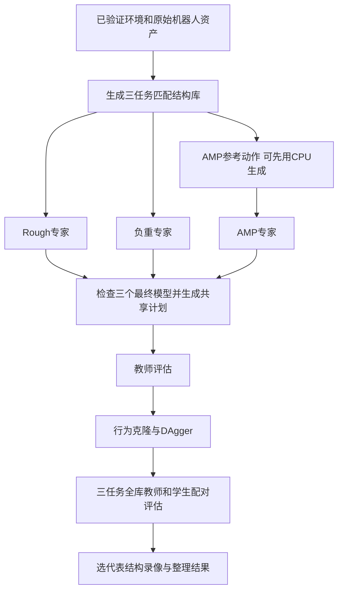

# 三任务跨形态训练与共享策略：完整操作流程

本页是当前Linux服务器的操作主线，按“输入 → 命令 → 完成证据 → 下一步”组织。已经完成的阶段直接跳过，不为更新文档重跑。模型与实验结果不放进Git；源码、配置、冻结分组和操作说明由Git管理。

## 0. 流程和当前能力



三个专家分别训练自己的策略；BC/DAgger将三个冻结教师融合为一个任务和形态条件化的共享Actor。蒸馏不是共享PPO微调，训练结束也不是步态通过。当前`shared_policy/joint_finetune.py`是固定结构的小实验，**不能作为本3000结构流程的默认下一步**。旧Rough BO也是独立协议，见 [BO与扩展边界](EXTENSIONS.md)。

已经生成结构库和AMP参考动作的用户，从第4节启动专家即可。不要重新生成或更换这些文件路径。

## 1. 每个新终端先设置路径

以下第一行按实际仓库位置修改；其余路径由仓库推导。命令使用已有的`robo_cjl`环境，不安装或升级Isaac版本。

```bash
cd /data/chenjiale/robo_cjl
conda activate robo_cjl
export REPO="$PWD"
export ENTRY="$REPO/robolab/experiments/multitask_morphology"
export ROOT="$REPO/robolab/logs/multitask_full3000_balanced_v2"
export TEMPLATE="$REPO/robolab/data/robots/roboparty/rpo/urdf/rpo.urdf"
export MESH_DIR="$REPO/robolab/data/robots/roboparty/rpo/meshes"
export GPU=cuda:1
export PYTHONUTF8=1
export PYTORCH_CUDA_ALLOC_CONF=expandable_segments:True
```

这些变量只在当前终端有效。换终端必须重设；`ENTRY`为空会把启动路径变成`/train.py`。`ROOT`固定表示这一批结构库、教师和共享策略的实验根目录，不要为了切换任务修改ROOT。

只读检查入口、原始资产与Python：

```bash
python --version
git log -1 --oneline
ls "$ENTRY/train.py" "$TEMPLATE"
test -d "$MESH_DIR" && echo ORIGINAL_MESH_DIRECTORY_FOUND
```

原始机器人资产不随当前代码完整分发。若缺失，按 [环境与资产说明](SETUP.md)补齐**已验证版本**，不要拿生成后的候选机器人当原始模板。

## 2. 生成三任务结构库：只做一次

首次生成时ROOT必须不存在。不要提前在ROOT里建立日志、环境记录或参考动作目录。

```bash
python -u "$ENTRY/prepare.py" --output-root "$ROOT" \
  --template "$TEMPLATE" --mesh-dir "$MESH_DIR" --generate-assets
```

完成证据：`THREE_TASK_BANKS_VALIDATED`，以及以下文件全部存在：

```text
ROOT/banks/rough/bank.json
ROOT/banks/backpack/bank.json
ROOT/banks/amp/bank.json
ROOT/bank_audit.json
```

三个任务共用腿长和电机设计；负重另有背包附件。每个bank共3000种结构，原生形态条件29维。不要用旧900或400结构bank替换其中一个任务。

ROOT已存在且结构库完整时跳过生成，可以独立复核，输出一个新的审计文件：

```bash
python "$ENTRY/audit_banks.py" \
  --rough-bank "$ROOT/banks/rough/bank.json" \
  --backpack-bank "$ROOT/banks/backpack/bank.json" \
  --amp-bank "$ROOT/banks/amp/bank.json" \
  --output "$ROOT/bank_recheck_$(date +%Y%m%d_%H%M%S).json"
```

首次生成中断、ROOT部分存在时，保留现场并按 [排错说明](RECOVERY.md)检查，不要删除整个实验根目录后盲目重跑。

## 3. 提前生成AMP参考动作

训练环境为Python3.11；参考动作使用独立的Python3.12 HHTools环境。只在尚未安装该环境或明确需要重新部署时运行：

```bash
python "$ENTRY/amp_engine/setup_hhtools.py" --env-name amp_hhtools
```

已有可用环境、尤其参考动作已经生成完成时，不为读文档重装。安装细节和版本来源见 [环境说明](SETUP.md)。

没有空闲显卡，可以单独CPU生成，不启动Isaac场景或PPO：

```bash
conda run --no-capture-output -n amp_hhtools python -u \
  "$ENTRY/amp_engine/prepare_references.py" \
  --bank "$ROOT/banks/amp/bank.json" --output "$ROOT/references" \
  --hhtools-root "$ENTRY/amp_engine/vendor/hhtools" --device cpu
```

有空闲卡时，单独GPU生成的等价命令如下。这里用CUDA可见设备掩码选物理1号卡，子进程因此使用`cuda:0`；不要再把子进程写成`cuda:1`：

```bash
CUDA_VISIBLE_DEVICES=1 conda run --no-capture-output -n amp_hhtools python -u \
  "$ENTRY/amp_engine/prepare_references.py" \
  --bank "$ROOT/banks/amp/bank.json" --output "$ROOT/references" \
  --hhtools-root "$ENTRY/amp_engine/vendor/hhtools" --device cuda:0
```

CPU和GPU两条只选一条。输出目录必须尚不存在；生成器按真实运动学复用结果，不承诺固定运行时长或固定独立运动学数量。完成证据是`SPATIAL_AMP_REFERENCES_READY`和`ROOT/references/library.json`。真正新运动学需要对应的新参考。

已有完整library时，训练直接校验复用，无须重做。当前独立生成器**没有部分目录断点续生成选项**；中断后的部分结果不是可用完整库，也不能手写library伪装完成。保留部分目录，见排错说明。

## 4. 分别训练三个跨形态专家

前提：对应bank完整；AMP还需要完整reference library，或允许启动器先自动生成。先用`nvidia-smi`确认GPU，按实际空闲卡修改GPU变量。以下命令分别执行，避免把三个任务同时放在一张卡上。

Rough：

```bash
python -u "$ENTRY/train.py" --task rough \
  --bank "$ROOT/banks/rough/bank.json" --output-root "$ROOT/experts/rough" \
  --device "$GPU" --gpu-min-free-gb 12.5 --gpu-max-utilization 100 --execute
```

负重：

```bash
python -u "$ENTRY/train.py" --task backpack \
  --bank "$ROOT/banks/backpack/bank.json" --output-root "$ROOT/experts/backpack" \
  --device "$GPU" --gpu-min-free-gb 12.5 --gpu-max-utilization 100 --execute
```

AMP：

```bash
python -u "$ENTRY/train.py" --task amp \
  --bank "$ROOT/banks/amp/bank.json" --output-root "$ROOT/experts/amp" \
  --reference-library "$ROOT/references/library.json" \
  --reference-device cuda --hhtools-env amp_hhtools \
  --device "$GPU" --gpu-min-free-gb 12.5 --gpu-max-utilization 100 --execute
```

即使library由CPU生成，上述AMP命令也会复用通过验证的现有库，不会因为`--reference-device cuda`而重新生成。

| 参数 | 当前正式设置 |
|---|---|
| 全库 | 大腿10档 × 小腿10档 × 膝5款 × 踝6款＝3000种 |
| 长度范围 | 大腿0.20–0.40m，小腿0.25–0.45m，允许经授权的GP外推 |
| 空间并行 | 4096环境，每组60种，每种68或69个副本 |
| 时间轮换 | 每组50次PPO更新；50组＝2500次更新覆盖全库一轮 |
| 分组 | 冻结优化排表；每组30种电机组合各2次，每档腿长各6次 |
| Rough、负重 | 各12000次更新，240阶段，4轮＋第5轮40组 |
| AMP | 5000次更新，100阶段，完整2轮 |
| 电机 | 全身23关节动态扭矩硬包络与统一−12软惩罚，超过动态可用扭矩80%部分平方求和，步长只乘一次 |

完整参数及零可用力矩边界见 [配置与方法](../robolab/experiments/multitask_morphology/README.md)。不要用预览计数、阶段完成或初始warmup完成替代整个任务预算。

去掉`--execute`是计划检查，可能创建任务输出目录。若已经这样预览过，再执行时同目录需要`--resume --execute`，不能按首次创建重复启动。该区别及失败恢复见 [恢复说明](RECOVERY.md)。

## 5. 检查三个最终教师

任务完成后，模型位置以各自`completed.json`为准，不靠猜attempt目录或挑最大的文件名。Rough/负重最终更新编号通常是`model_11999.pt`，AMP是`model_4999.pt`；编号从0开始。

```bash
python "$ENTRY/validate_teacher.py" --task stairs --root "$ROOT/experts/rough"
python "$ENTRY/validate_teacher.py" --task backpack --root "$ROOT/experts/backpack"
python "$ENTRY/validate_teacher.py" --task run --root "$ROOT/experts/amp"
```

注意：统一训练入口的任务名是`rough/backpack/amp`，内部审计/评估任务名是`stairs/backpack/run`。校验器检查预算、bank、源码身份、策略/价值函数、Adam状态及AMP参考库；通过后输出JSON。它只证明训练链完整，**不证明步态通过**。

## 6. 生成共享计划，先看教师表现

三个教师均完成后：

```bash
python -u "$ENTRY/prepare_shared.py" \
  --rough-root "$ROOT/experts/rough" \
  --backpack-root "$ROOT/experts/backpack" \
  --amp-root "$ROOT/experts/amp" --output "$ROOT/shared_plan"
```

输出目录必须新建；完成标志是`SHARED_PLAN_VALIDATED`。计划冻结三个教师、实际bank、参考动作哈希及完全相同的结构集合。当前正式流程要求全库匹配，不接收随意混合旧教师或只替换其中一个bank。

随后按 [评估与录像](EVALUATION.md)先抽代表结构评估教师。教师不稳定时先分析原始轨迹，不要通过放宽学生阈值掩盖教师问题。当前这套统一rollout需要共享计划，因此这一步在三个教师都完成后进行。

## 7. BC＋DAgger训练共享Actor

```bash
python -u "$ENTRY/distill.py" --plan "$ROOT/shared_plan/plan.json" \
  --output "$ROOT/shared_actor" --device "$GPU" \
  --batch-designs 10 --collect-steps 1000 --stride 5 \
  --epochs 20 --dagger-rounds 3 --timeout-seconds 1800 \
  --gpu-min-free-gb 12.5 --gpu-max-utilization 100
```

该命令**立即执行**，不需要`--execute`。先采集教师演示做BC，再做3轮学生状态上的DAgger。三个教师始终冻结。每任务等权采样，任务内均匀选结构；默认每个结构/来源/训练验证分流最多保留32行参与拟合，原始文件保留，避免全部轨迹同时载入内存。

最终自动执行全共同库的三任务教师/学生配对评估。看`shared_actor/completed.json`中的`nominal_passed`和各批次原始summary：完整20秒、不摔、前进速度至少0.1m/s；楼梯另需上升至少0.1m。横移不作为失败条件。低MSE、完成BC或进程正常退出均不是步态通过。

失败时按实际证据分析，不能自动加预算、改奖励或换物理后沿用原实验身份。继续原流程时使用完全相同命令加`--resume`；要改变训练预算/配置，应另建并记录实验。

## 8. 交付与备份

按 [评估与录像](EVALUATION.md)输出三个任务录像与汇总。目录和必备证据见 [数据与身份说明](ARTIFACTS.md)。至少保留：源码提交、实际bank/参考库、三个教师完成记录与模型、共享计划、最终学生、原始评估summary及视频索引。

Git提交代码和文档，不把模型、视频或整个实验根目录提交进去。历史数据不移动、覆盖或清理。服务器在线更新和合并问题见 [恢复与更新](RECOVERY.md)。
