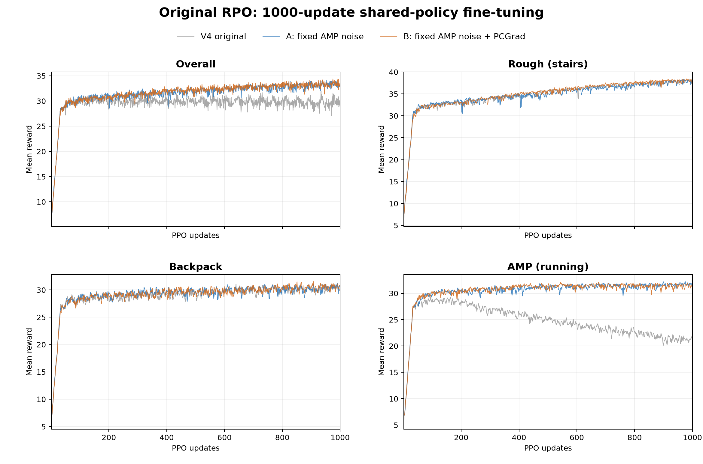

# 原机共享微调：三任务独立收敛纠正

基于实际 V4 原机 1000 代日志：AMP 原始每步环境奖励下降、提前终止增加，同时继承的 AMP 动作噪声持续增大。Rough 和负重的改善不能抵消 AMP 的退化作为收敛判据。

## 顺序对照

- A `fixed_amp_std`：只冻结 AMP 专家最后的 23 个真实动作标准差，其他两任务的噪声仍由原生 PPO 学习。保留所有原生奖励、判别器、Critic、5×4 PPO和4096环境。每25代额外记录一次同批共享Actor各任务梯度的余弦（不改变更新）。
- B `fixed_amp_std_pcgrad`：不论 A 的结果是否通过，都独立执行完整对照。仍从相同第五轮共享 Actor 和教师先验从头微调；在 A 的基础上将共享 Actor 的三项 PPO surrogate 和对称损失的梯度贡献做 PCGrad 投影（固定循环投影顺序），保留 Critic、噪声、判别器和 Adam 的原生更新。依据 [Yu 等，NeurIPS 2020](https://proceedings.neurips.cc/paper/2020/file/3fe78a8acf5fda99de95303940a2420c-Paper.pdf)。

每组完整1000次正式更新及10次 Critic 预热，固定种子、同模型、同原机、独立目录。实验设置写入 manifest，不能被未修改的正式 BO 视为同一算法配置。

## 自动选择与恢复

按各任务独立检查全部1000代原始 Mean reward：最后100代不比旧V4第51–150代或本轮稳定段最佳100代均值低超过5%；最后两个100代窗口均值差与末200代拟合漂移均不超过5%。这是明确的操作性稳定标准，不是数学证明。曲线过关后才在原来的固定工况、固定种子、200Hz下测量三个任务，要求三项都成功。保存未通过的原始证据，不依总体均值选模。

`ppo_correction_study.py` 依序完整测试 A、B，记录原始奖励曲线、优化诊断、梯度诊断、实际步态原始数据及模型校验。两组均结束后，在通过独立收敛及三项步态检查的方案中，用既有十二项原机分母比较最差任务代价（越小越好；总体代价作为次级选择），生成 `selected.json`；之后才允许自动恢复已有单结构专家训练。专家的原训练计划和检查点不变，最终对照以获选纠正版1000代共享 Actor 为被比较对象。原始正式 BO 第100代归一化文件不自动改动，也不自动启动 BO。

## 已完成的实测结果（2026-11-26）

原机结构为大腿 0.25 m、小腿 0.30 m、膝 DM-J10010L-2EC、踝 DM-J4340P-2EC；三任务结构 ID 均为 `tr_792ca9f47877`。A、B 都从同一第五轮蒸馏 Actor（SHA256 `ccc8fae759cf0eff5db8df43b908fd29eb8cc12ce4216c467ed1d2a8759d4c90`）初始化，训练种子 20261104，实际执行 1000 代正式联合 PPO，不是将 A 的模型接着训练成 B。

| 方案（最后100代平均） | 总体 | Rough | 负重 | AMP |
|---|---:|---:|---:|---:|
| 原 V4（对照） | 29.620 | 37.754 | 30.263 | 21.272 |
| A 冻结 AMP 噪声 | 33.209 | 37.812 | 30.298 | 31.657 |
| B 冻结 AMP 噪声 + PCGrad | 33.263 | 38.004 | 30.517 | 31.391 |

A 与 B 的三项独立稳定性检查均通过，B 最后 200 代的拟合变化分别约 +0.600、+0.151、+0.108。原始均值窗口、奖励定义均未修改。最后100代 AMP 训练日志中，原 V4 / A / B 的平均每步环境奖励分别为 0.021829 / 0.031765 / 0.031700，非超时终止次数占结束回合的比例为 4.867% / 0.850% / 1.267%。原 V4 的 AMP 平均动作标准差为 0.578277，而 A、B 保持教师的实际 23 维噪声向量（均值 0.371098）。由此可见，冻结 AMP 噪声本身已足以在该实验消除明显退化，而非仅修饰统计图。PCGrad 是额外的任务梯度冲突处理；单次对照不能证明它在所有形态上都必然更优。

两组正式采样和更新累计用时分别为约 1小时51分、2小时03分（不含初始化、预热、写入和评估开销）。每组动力学评估均使用三项固定工况、单种子 20261118、20 秒、200 Hz、关闭评估随机化。上楼 0.5 m/s，楼梯高 0.075 m、踏面深 0.30 m；负重 10 kg、0.5 m/s；跑步 1.5 m/s。

| 方案 | 上楼水平行程 m | 负重水平行程 m | 跑步水平行程 m | 三项存活及成功 |
|---|---:|---:|---:|---|
| A | 7.169 | 9.827 | 27.682 | 均成功 |
| B | 8.495 | 9.868 | 28.329 | 均成功 |

两组均完成每项 4000 个物理步，无摔倒。以下评分继续用现有 V4 第100代原机四指标分母，综合代价越小越好；这些分数不是重新归一化后的评分。

| 方案 | 上楼 | 负重 | AMP | 最差任务代价 | 综合代价 |
|---|---:|---:|---:|---:|---:|
| A | 1.318747 | 0.996866 | 1.027998 | 1.318747 | 1.134958 |
| B | 1.019614 | 1.002831 | 1.061861 | 1.061861 | 1.027253 |

因此按事先确定的最差任务优先规则选用 B，综合代价相对 A 低约 9.49%。B 的 AMP 平均 reward 略低于 A，且两组综合代价仍高于正式 V4 第100代原机基准 1，故不应将此次结果表述为 B 已优于原先所有模型，也不自动替换正式 BO 分母。

所选 B 的 Actor SHA256：`1ae4f797b4c5c08f7bd2d6607ee0aa30bed8c1669b011e876fb4fbbf949c7a7b`。所有六份任务原始报告及 200 Hz NPZ 轨迹的 SHA256 均按原始验收记录逐一验证。在 [原始实验数据目录](reference/rpo_ppo_correction_20261126/) 中同时保留原 V4、A、B 三套1000代奖励和优化诊断，独立稳定性评估、六份步态报告及轨迹、模型回执和选择回执。模型权重保留在原运行目录，不加入 Git。

原机三专家对比实验已按照授权恢复：Rough 从 `model_335.pt`（已完成336代）续训，恢复检查证实 policy、归一化器及 Adam 参数一致，续训 CSV 自337代开始，已核实到390代。后台控制器继续依次执行 Rough 12000、负重12000、AMP5000代，不使用共享 Actor 初始化专家；最终另做同工况性能对比。两处后台汇总状态错误分别修复了实际报告的平铺字段读取及控制器/专家 PID 字段重名，训练检查点与已验收轨迹均未重生成。
