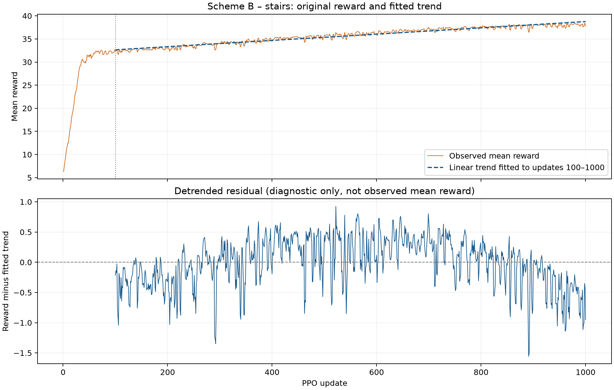

# 原机共享微调：三任务独立收敛纠正

基于实际 V4 原机 1000 代日志：AMP 原始每步环境奖励下降、提前终止增加，同时继承的 AMP 动作噪声持续增大。Rough 和负重的改善不能抵消 AMP 的退化作为收敛判据。

## 顺序对照

- A `fixed_amp_std`：只冻结 AMP 专家最后的 23 个真实动作标准差，其他两任务的噪声仍由原生 PPO 学习。保留所有原生奖励、判别器、Critic、5×4 PPO和4096环境。每25代额外记录一次同批共享Actor各任务梯度的余弦（不改变更新）。
- B `fixed_amp_std_pcgrad`：不论 A 的结果是否通过，都独立执行完整对照。仍从相同第五轮共享 Actor 和教师先验从头微调；在 A 的基础上将共享 Actor 的三项 PPO surrogate 和对称损失的梯度贡献做 PCGrad 投影（固定循环投影顺序），保留 Critic、噪声、判别器和 Adam 的原生更新。依据 [Yu 等，NeurIPS 2020](https://proceedings.neurips.cc/paper/2020/file/3fe78a8acf5fda99de95303940a2420c-Paper.pdf)。

每组完整1000次正式更新及10次 Critic 预热，固定种子、同模型、同原机、独立目录。实验设置写入 manifest，不能被未修改的正式 BO 视为同一算法配置。

## 自动选择与恢复

按各任务独立检查全部1000代原始 Mean reward：最后100代不比旧V4第51–150代或本轮稳定段最佳100代均值低超过5%；最后两个100代窗口均值差与末200代拟合漂移均不超过5%。这是明确的操作性稳定标准，不是数学证明。曲线过关后才在原来的固定工况、固定种子、200Hz下测量三个任务，要求三项都成功。保存未通过的原始证据，不依总体均值选模。

`ppo_correction_study.py` 依序完整测试 A、B，记录原始奖励曲线、优化诊断、梯度诊断、实际步态原始数据及模型校验。两组均结束后，在通过独立收敛及三项步态检查的方案中，用既有十二项原机分母比较最差任务代价（越小越好；总体代价作为次级选择），生成 `selected.json`；之后才允许自动恢复已有单结构专家训练。专家的原训练计划和检查点不变，最终对照以获选纠正版1000代共享 Actor 为被比较对象。原始正式 BO 第100代归一化文件不自动改动，也不自动启动 BO。

## 已完成的实测结果（2026-11-26）

原机结构为大腿 0.25 m、小腿 0.30 m、膝 DM-J10010L-2EC、踝 DM-J4340P-2EC；三任务结构 ID 均为 `tr_792ca9f47877`。A、B 都从同一第五轮蒸馏 Actor（SHA256 `ccc8fae759cf0eff5db8df43b908fd29eb8cc12ce4216c467ed1d2a8759d4c90`）初始化，训练种子 20261104，实际执行 1000 代正式联合 PPO，不是将 A 的模型接着训练成 B。


| 方案（最后100代平均） | 总体 | Rough | 负重 | AMP |
|---|---:|---:|---:|---:|
| 原 V4（对照） | 29.620 | 37.754 | 30.263 | 21.272 |
| A 冻结 AMP 噪声 | 33.209 | 37.812 | 30.298 | 31.657 |
| B 冻结 AMP 噪声 + PCGrad | 33.263 | 38.004 | 30.517 | 31.391 |

A 与 B 的三项独立稳定性检查均通过，B 最后 200 代的拟合变化分别约 +0.600、+0.151、+0.108。原始均值窗口、奖励定义均未修改。最后100代 AMP 训练日志中，原 V4 / A / B 的平均每步环境奖励分别为 0.021829 / 0.031765 / 0.031700，非超时终止次数占结束回合的比例为 4.867% / 0.850% / 1.267%。原 V4 的 AMP 平均动作标准差为 0.578277，而 A、B 保持教师的实际 23 维噪声向量（均值 0.371098）。由此可见，冻结 AMP 噪声本身已足以在该实验消除明显退化，而非仅修饰统计图。PCGrad 是额外的任务梯度冲突处理；单次对照不能证明它在所有形态上都必然更优。

两组正式采样和更新累计用时分别为约 1小时51分、2小时03分（不含初始化、预热、写入和评估开销）。每组动力学评估均使用三项固定工况、单种子 20261118、20 秒、200 Hz、关闭评估随机化。上楼 0.5 m/s，楼梯高 0.075 m、踏面深 0.30 m；负重 10 kg、0.5 m/s；跑步 1.5 m/s。

| 方案 | 上楼水平行程 m | 负重水平行程 m | 跑步水平行程 m | 三项存活及成功 |
|---|---:|---:|---:|---|
| A | 7.169 | 9.827 | 27.682 | 均成功 |
| B | 8.495 | 9.868 | 28.329 | 均成功 |

两组均完成每项 4000 个物理步，无摔倒。以下评分继续用现有 V4 第100代原机四指标分母，综合代价越小越好；这些分数不是重新归一化后的评分。

| 方案 | 上楼 | 负重 | AMP | 最差任务代价 | 综合代价 |
|---|---:|---:|---:|---:|---:|
| A | 1.318747 | 0.996866 | 1.027998 | 1.318747 | 1.134958 |
| B | 1.019614 | 1.002831 | 1.061861 | 1.061861 | 1.027253 |

因此按事先确定的最差任务优先规则选用 B，综合代价相对 A 低约 9.49%。B 的 AMP 平均 reward 略低于 A，且两组综合代价仍高于正式 V4 第100代原机基准 1，故不应将此次结果表述为 B 已优于原先所有模型，也不自动替换正式 BO 分母。

所选 B 的 Actor SHA256：`1ae4f797b4c5c08f7bd2d6607ee0aa30bed8c1669b011e876fb4fbbf949c7a7b`。所有六份任务原始报告及 200 Hz NPZ 轨迹的 SHA256 均按原始验收记录逐一验证。在 [原始实验数据目录](reference/rpo_ppo_correction_20261126/) 中同时保留原 V4、A、B 三套1000代奖励和优化诊断，独立稳定性评估、六份步态报告及轨迹、模型回执和选择回执。模型权重保留在原运行目录，不加入 Git。

原机三专家对比实验已按照授权恢复：Rough 从 `model_335.pt`（已完成336代）续训，恢复检查证实 policy、归一化器及 Adam 参数一致，续训 CSV 自337代开始，已核实到390代。后台控制器继续依次执行 Rough 12000、负重12000、AMP5000代，不使用共享 Actor 初始化专家；最终另做同工况性能对比。两处后台汇总状态错误分别修复了实际报告的平铺字段读取及控制器/专家 PID 字段重名，训练检查点与已验收轨迹均未重生成。

## 正式方案及楼梯奖励诊断

2026-11-26 选定 B 为新的默认共享微调协议：`shared_native_ppoamp_expert_prior_pcgrad_fixed_amp_std`。此前的 A、B 对照实验与 V4 保持原身份和原始记录；新候选使用单独的算法身份，检查点不与历史 V4 混用。BO 仍须先按照 B 的100次更新预算测得新原机基准及初始50个结构，不使用旧 V4 分母。

楼梯的原始 Mean reward 在第100代至第1000代仍然提高。为了区分长期趋势和局部波动，单独对第100–1000代原始楼梯奖励做线性最小二乘拟合，残差定义为每代原始奖励减去该代拟合值。拟合趋势总增量约6.114；残差图只用于观察波动，不等于原始 Mean reward，也不能证明第100代就已收敛。原始 CSV、完整1000代图和原始评估数据保持不变。



对应 [去趋势逐代诊断 CSV](reference/rpo_ppo_correction_20261126/stairs_detrended_diagnostic.csv) 同时列出观测值、拟合值和残差，便于独立复核。

## 楼梯加权独立试验（待实测）

在正式方案 B 之上另设实验配置 `fixed_amp_std_pcgrad_stairs_weight2`：全部1000次正式更新的共享 Actor 任务梯度相对权重为上楼：负重：跑步 = 2:1:1，按均值为1归一化后进行 PCGrad。不是仅在前100代提高权重；三项环境数、奖励、Critic、AMP固定噪声、判别器及其他 PPO 超参数不变。该试验独立从同一第五轮共享 Actor 和原机结构出发，完整保留逐代原始 Mean reward 与实际使用的梯度权重，正式 B 和 BO 评分协议不自动修改。完成后比较前100代的水平、后续真实趋势、三个任务各自的稳定性和实际步态，不以绘图调整冒充收敛。

依用户指示，加权试验于第590代停止，停前50代楼梯/负重/AMP均值为36.776/29.819/31.488，第51–100代楼梯均值32.183，仅略高于正式B同窗口32.010，并未实现100代平台。断点和原始日志保持不变。

下一项独立试验 `fixed_amp_std_pcgrad_kl002` 恢复B的等权任务梯度，只将 Adam 自适应的目标 KL 由0.01改为0.02。`ppo_kl_pilot.py` 从相同第五轮 Actor、结构、随机种子和4096个环境独立执行200次正式更新；全部记录实际使用的目标 KL。比较第51–100和151–200代奖励与B的相同窗口，若没有明显增益或者其他任务发生退化，不自动继续1000代。该试验仍不改变正式B及BO基准。

200代实测显示，提高目标 KL 并未提升楼梯前期学习效率，因此按预定判据结束，不替换正式方案 B。按用户要求删除两组未达目标的实验模型及结果，只保留此处简要结论以避免重复试验。正式 B 和单结构专家断点不变。

## 楼梯样本比例试验（待实测）

`fixed_amp_std_pcgrad_stairs_samples_2048` 独立比较将4096个并行环境分配为上楼2048、负重1024、跑步1024。每代仍各采24个控制步，三项分别产生49152、24576、24576条样本，总计98304，与正式B相同。楼梯实际样本数提高约50%，另外两个各减少约25%；PCGrad、AMP固定噪声、原始目标KL 0.01、奖励和优化器超参不变，不再附加楼梯梯度权重。完整执行1000次正式更新，逐代核对实际采样数；分任务原始 Mean reward 是主要对照，总体统计受环境分配影响。曲线和真实步态结果未验证前，不替换正式方案 B。

实测1000代已完成，全部3000个任务/更新采样记录符合上述比例；三任务最终稳定性均通过，4000步固定工况评估三项均无摔倒。但楼梯第51–100代均值32.386、最后100代38.969，仍未实现100代的平台（原B分别32.010、38.004）。负重和AMP最后100代分别30.255、31.443。新布局在固定原机分母下综合代价1.042576，原B为1.027253；因此不替换正式B。模型与评估、曲线保留供本次结果审查。

## 独立 V4 楼梯 5120 环境与 10 Epoch 收敛试验

本试验使用显式实验配置 `v4_stairs5120_epoch10`，不是当前正式方案 B，也不替换正式 BO。沿用原 V4 原机对照的预测形态（大腿 250 mm、小腿 300 mm、膝 10010L、踝 4340P）、第五轮共享 Actor、三个专家 Critic 与探索参数、随机种子 20261104、原始奖励和鲁棒随机化。单场景分配上楼 5120、负重 512、AMP 512 个环境（总计 6144）；每环境每代 24 个控制步，实际分别采样 122880、12288、12288 条，每代 10 Epoch × 4 个小批；先进行 10 代 Critic 预热，再正式更新 1000 代。保留第 0、100、200……1000 代完整模型和每代原始指标，未完成相邻百代之间的更新可从最近完整模型重做；不改变普通 BO 每 10 代完整保存的规则。

完成后只分析训练曲线，不启动额外固定工况评估：

```bash
python robolab/experiments/multitask_morphology/rpo_stairs5120_epoch10_report.py \
  --tuning "$tuning" --output "$report" \
  --control-wall-seconds 8227.757877675816 \
  --experiment-wall-seconds "$actual_worker_wall_seconds"
```

分析工具核验既有 V4 1000 代对照、同一原机计划和 Actor、11 个完整检查点及 1000 代逐代奖励和采样记录，输出三张原始 Mean reward 对照图（横轴为正式更新代数、累计实际采样与采样+优化器计算时间）、逐代 CSV 和收敛诊断 JSON。判据透明：以前一对照最后 100 代均值减去其绝对值的 5% 为参考奖励水平，记录首次连续 50 个 50 代滚动均值达到该水平时的更新数、采样量和计算时间。总 Mean reward 的任务回合组成随环境分配变化，优先比较三条分任务原始曲线；等任务平均只作补充诊断。本试验同时改变环境数和 Epoch，不能把差异单独归因，也不据其宣称固定工况性能提升或自动改动正式 BO。
