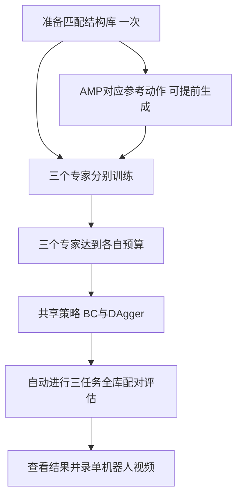

# 完整流程：从结构库到共享策略录像

日常开训练只看[快速启动](../快速启动.md)。本页是完整顺序；每个步骤的路径都由 `启动.py` 推导，不要求手工复制实验路径。



## 1. 环境与资产：只准备一次

训练使用已有 `robo_cjl` 环境；参考动作使用独立 `amp_hhtools` 环境。原始URDF及网格放在仓库约定的机器人资产位置。具体版本、缺失资产处理及HHTools重绑定见[环境与资产准备](环境与资产准备.md)。

这些已准备完成时直接跳到第3步；不为更新文档重装或升级环境。

## 2. 可选：提前准备结构库和参考动作

三个训练命令都能先准备结构库。若想在没有空闲训练卡时先做准备，可单独运行：

```bash
conda run --no-capture-output -n robo_cjl python /data/chenjiale/robo_cjl/启动.py 准备
```

提前用CPU生成AMP参考动作，不启动PPO：

```bash
conda run --no-capture-output -n robo_cjl python /data/chenjiale/robo_cjl/启动.py 参考动作 --cpu
```

有空闲0号卡时可改用GPU生成；与上条只选一条：

```bash
conda run --no-capture-output -n robo_cjl python /data/chenjiale/robo_cjl/启动.py 参考动作 --gpu 0
```

参考动作与仿真USD资产不同。前者匹配AMP的真实运动学，后者由Isaac原生导出器生成；GPU参考动作生成并不能加速URDF转USD。已有完整参考库时不会重复生成。

## 3. 训练三个专家

从[快速启动](../快速启动.md#第二步选择一个任务复制对应的一行)复制任务命令即可。每个专家有独立模型，结构参数一致；任务全部完成前，不会自动把它们当成一个共享策略。

| 项目 | 正式值 |
|---|---|
| 结构库 | 大腿10档 × 小腿10档 × 膝5款 × 踝6款，共3000种 |
| 长度 | 大腿0.20–0.40m，小腿0.25–0.45m，允许已授权GP外推 |
| 并行 | 4096环境，每组60种，每种68或69份 |
| 换组 | 每组50次PPO更新；50组覆盖一整轮 |
| Rough与负重 | 各12000次PPO更新 |
| AMP | 5000次PPO更新 |
| 执行器 | 全身23关节真实曲线硬约束及统一−12动态扭矩软惩罚 |

[结构分组轮换训练方法](结构分组轮换训练方法.md)解释分组依据、轮换过程和实际搭配；[三任务训练说明](../robolab/experiments/multitask_morphology/三任务训练说明.md)列出详细配置。

资产转换进度、首阶段失败、续训和源码身份问题见[异常处理与续训](异常处理与续训.md)。保持原始结果，不能通过删除目录来解决报错。

## 4. 三个专家完成后，融合为一个共享策略

```bash
conda run --no-capture-output -n robo_cjl python /data/chenjiale/robo_cjl/启动.py 蒸馏 --gpu 0
```

入口自动找到三个任务的训练目录，要求三个完成文件存在；底层验证器进一步检查预算、检查点、源身份及AMP参考动作。通过后建立全库对应计划，进行行为克隆和3轮DAgger，结束后自动进行三个任务的教师/学生配对评估。

再次执行同一条命令会按原计划恢复。BC与DAgger不会训练共享PPO critic，也不会修改教师参数。共享训练执行结束不等于步态通过：以 `shared_policy/completed.json` 中的 `nominal_passed` 为准。三个任务必须分别通过，不能只看拟合误差或平均奖励。

默认每次采样10种结构；采样1000步、间隔5步保存；每轮拟合20个epoch。该命令是有限预算流程，不承诺一次就达标；未达标保留真实结果，不自动增加训练。

## 5. 看单机器人视频

共享蒸馏执行完成后，下列命令各录一个任务。默认选本库第0个结构，只显示一个机器人；负重录像使用10kg。结果自动放入本实验的 `videos/`，终端会打印具体位置。

```bash
conda run --no-capture-output -n robo_cjl python /data/chenjiale/robo_cjl/启动.py 录像 --任务 rough --gpu 0
```

```bash
conda run --no-capture-output -n robo_cjl python /data/chenjiale/robo_cjl/启动.py 录像 --任务 负重 --gpu 0
```

```bash
conda run --no-capture-output -n robo_cjl python /data/chenjiale/robo_cjl/启动.py 录像 --任务 amp --gpu 0
```

想换结构，在录像命令末尾加 `--结构 100` 即可；序号从0开始，仍在已训练库内选择，不生成新形态。想评估库外形态，须先按真实运动学生成相应AMP参考动作，不绕过结构身份检查。

录像不能替代全库评估。通过标准及原始数据解释见[评估与录像](评估与录像.md)，文件保留范围与索引模板见[结果归档与录像索引](结果归档与录像索引.md)。

## 最后得到什么

- 三个独立、带形态条件的教师策略及各自完整训练记录。
- 一个任务和形态条件化的共享Actor，以及三个任务分别的配对评估结果。
- 单机器人录像、结构参数记录与录像索引。

目前不把旧固定形态共享PPO小实验或旧Rough BO自动接到该流程后面，原因见[优化与扩展边界](优化与扩展边界.md)。
